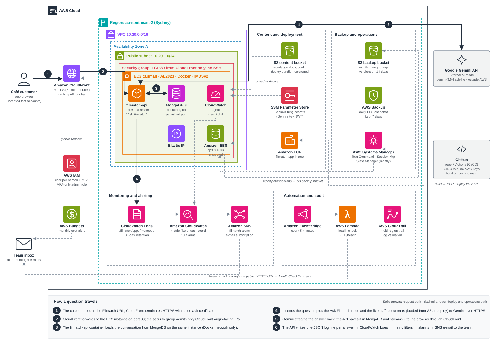

# Filmatch on AWS — deployment and operations

Everything needed to deploy and run Filmatch on AWS for SAM10 workstreams WS-B to WS-F.
Infrastructure is CloudFormation. Deploys go through GitHub Actions → ECR → SSM, with no SSH and no AWS keys anywhere.



## What is where

| Path | Purpose |
| --- | --- |
| `cloudformation/filmatch-account-baseline.yaml` | Once per account: operators group with enforced MFA, MFA-only admin role, CloudTrail, Budgets, optional GuardDuty |
| `cloudformation/filmatch-app.yaml` | VPC, EC2, CloudFront (HTTPS), S3 ×2, ECR, logs, metric filters, 10 alarms, dashboard, SNS, health-check Lambda, nightly backup association, AWS Backup, GitHub deploy role |
| `instance/` | Uploaded to `s3://<content-bucket>/deploy/`; the EC2 instance runs it. Holds `docker-compose.aws.yml` and the deploy, backup, restore, fault and log-guard scripts |
| `bin/` | Run from a laptop (Git Bash) or CI: deploy stacks, put secrets, publish content, run remote commands, PII check, evidence capture |
| `../../.github/workflows/filmatch-deploy.yml` | CI/CD: push to `main` → build → ECR → S3 → SSM deploy |
| `../../api/server/utils/filmatchRequestLog.js` | One JSON log line per chat answer: question, duration, outcome, version |
| `docs/` | Architecture diagram and runbooks |

## One-time setup

Prerequisites: AWS CLI v2, Git Bash, and an AWS identity that can create IAM resources (for the very first step only). All commands run from the repository root. The scripts default to `AWS_REGION=ap-southeast-2`.

### 1. Account baseline (WS-D)

```bash
ALERT_EMAIL=team-inbox@example.com BUDGET_USD=25 bash deploy/aws/bin/deploy-stack.sh baseline
```

If the account already has a multi-region trail, add `CREATE_TRAIL=false`. For the stretch item, add `ENABLE_GUARDDUTY=true`.

Then, **in the console, for each team member**:

1. IAM → Users → create a personal user with console access only (no access keys). Add the user to the `filmatch-operators` group.
2. Sign in as that user and register an MFA device. Until you do, the group's policy denies everything else.
3. For admin work, use **Switch role** with the `SwitchRoleUrl` output. Sessions last 1 hour and require MFA.
4. Root user: enable MFA, then stop using it.
5. Optional password policy: `aws iam update-account-password-policy --minimum-password-length 14 --require-symbols --require-numbers --require-uppercase-characters --require-lowercase-characters`

Assume the admin role for CLI work by adding this to `~/.aws/config` (use your own account ID and user name):

```ini
[profile filmatch-admin]
role_arn = arn:aws:iam::<ACCOUNT_ID>:role/filmatch-admin
source_profile = <your-own-profile>
mfa_serial = arn:aws:iam::<ACCOUNT_ID>:mfa/<your-user>
region = ap-southeast-2
```

Then `export AWS_PROFILE=filmatch-admin` before running the scripts below.

### 2. Secrets into Parameter Store (WS-D #3)

```bash
bash deploy/aws/bin/put-secrets.sh      # prompts for the Gemini key (hidden), generates the rest
```

Every value goes to `/filmatch/app-env/*`: `GOOGLE_KEY`, `CREDS_KEY`, `CREDS_IV`, `JWT_SECRET` and `JWT_REFRESH_SECRET` as SecureString, and `GOOGLE_MODELS`, `ALLOW_REGISTRATION` and `APP_TITLE` as String. `deploy.sh` reads them into the shell at deploy time. They are never written to a file.

> Use a **new** Gemini key for AWS, and restrict it to the Generative Language API in Google AI Studio/Cloud Console. The key in your local `.env` has lived on a laptop; keep it for local use only.

### 3. Application stack

```bash
ALERT_EMAIL=team-inbox@example.com GITHUB_REPO=<owner>/<repo> bash deploy/aws/bin/deploy-stack.sh app
```

The first run takes about 10 minutes, mostly CloudFront. Afterwards:

- **Confirm the SNS subscription email.** Until you do, no alarm reaches anyone.
- Note the outputs: `AppUrl`, `GitHubDeployRoleArn`, `DashboardUrl`, `InstanceId`.

If the GitHub OIDC provider already exists in the account, add `CREATE_OIDC=false`.

### 4. First build and deploy

**Option A: GitHub Actions (recommended; also earns the WS-E stretch mark).** In the GitHub repo, go to Settings → Secrets and variables → Actions → **Variables** and set:

- `AWS_REGION` = `ap-southeast-2`
- `AWS_DEPLOY_ROLE_ARN` = the `GitHubDeployRoleArn` output

Then commit and push to `main`. The first image build takes about 20–30 minutes. After that, every push to `main` redeploys.

**Option B: from a laptop with Docker Desktop.**

```bash
bash deploy/aws/bin/build-and-push.sh
bash deploy/aws/bin/publish-content.sh
bash deploy/aws/bin/remote.sh deploy
```

### 5. Create the test accounts, then close registration

1. Open the `AppUrl` and register 1–2 **invented** accounts, for example `tester1@filmatch.test`.
2. Close registration and redeploy:

```bash
MSYS_NO_PATHCONV=1 aws ssm put-parameter --name /filmatch/app-env/ALLOW_REGISTRATION --value false --type String --overwrite
bash deploy/aws/bin/remote.sh deploy
```

## Day-to-day commands

| Task | Command |
| --- | --- |
| Redeploy now | `bash deploy/aws/bin/remote.sh deploy` |
| Containers, disk, memory | `bash deploy/aws/bin/remote.sh status` |
| Run a backup now | `bash deploy/aws/bin/remote.sh backup` |
| Restore test (side container) | `bash deploy/aws/bin/remote.sh restore-test` |
| Shell on the instance | `aws ssm start-session --target <InstanceId>` then `sudo -i` |
| Update the café documents | Edit `filmatch-document/*.md` → push to `main`, or run `publish-content.sh` + `remote.sh deploy` |
| PII check | `bash deploy/aws/bin/pii-check.sh` |
| Capture evidence | `bash deploy/aws/bin/evidence.sh > evidence-$(date +%F).txt` |
| Rotate the Gemini key | `bash deploy/aws/bin/put-secrets.sh --rotate-gemini && bash deploy/aws/bin/remote.sh deploy` |

## How each workstream is met

### WS-A item 4 — AWS integration beyond static hosting

- The five café documents and the config live in a private, versioned **S3** bucket.
- On every deploy the instance pulls them, rebuilds the assistant's knowledge snapshot in a staging folder, and swaps it in only if it validates. If fewer than five documents arrive, the deploy stops instead of serving stale content.
- Secrets come from **Parameter Store**.
- To demo it: change a price in S3, run `remote.sh deploy`, and ask in a new chat. Then restore the previous S3 version and repeat.

### WS-B — Monitoring

| Requirement | Where |
| --- | --- |
| Dashboard | `filmatch-operations`: requests, answers succeeded/failed/empty, answer time avg/p90, CPU, disk %, memory %, health check, backup size (database volume), failed %, live request-log table, alarm status |
| ≥ 6 alarms | 10 alarms, listed below |
| Alarms e-mail a real inbox | SNS topic `filmatch-alerts` with an email subscription |
| Log groups with retention | `/filmatch/app`, `/filmatch/mongodb`, `/aws/lambda/filmatch-healthcheck`, 30 days |
| Per-request log | `{"event":"filmatch_chat","outcome":"success","durationMs":2346,"question":"…","version":"<git sha>",…}` |
| Stretch: custom metric for useful answers | `AnswersSucceeded`, `AnswersFailed` and `EmptyAnswers` (metric filters) feed the failed-% and empty-answer alarms |

| Alarm | Threshold | Why |
| --- | --- | --- |
| high-cpu | > 85 % for 10 min | A stuck process or runaway loop, not a brief spike |
| status-check-failed | > 0 for 2 min | The instance itself is unhealthy |
| disk-used-high | > 85 % (5 min) | Time to act before MongoDB cannot write. 5 min instead of 1 h because a runaway log fills the disk in minutes |
| memory-high | > 90 % for 5 min | node or mongod is close to the OOM killer |
| answers-failed-rate | > 5 % of answers in 15 min | The system is up but not working (Gemini key, quota, 429) |
| empty-answers | > 0 in 30 min | Knowledge or config is missing or unreadable |
| slow-answers | average > 15 s over 5 min | Gemini Flash normally answers in a few seconds; 15 s is too long for a customer at the counter |
| app-errors | ≥ 10 error lines in 5 min | Catch-all for application failures |
| healthcheck-failed | `/health` failed twice in a row | Users cannot reach the site; missing data counts as failure |
| backup-missing | no successful backup in 24 h | A backup that silently stops is worse than none |

**Proof an alert arrived (E-08).** Trigger a real alarm, for example by stopping the app, and screenshot the email with its date and time:

```bash
bash deploy/aws/bin/remote.sh 'docker stop filmatch-api'
```

Wait about 10 minutes for `healthcheck-failed`. Then run `remote.sh deploy` and screenshot the OK email too.

### WS-C — Backup and restore

What would have to be restored:

1. MongoDB `LibreChat` database: users, conversations, messages.
2. S3 content: knowledge documents and config. The bucket is versioned and the repo holds a copy.
3. Secrets in Parameter Store. AWS manages their durability. Record the parameter names. If they are lost, re-run `put-secrets.sh` with a new Gemini key; new JWT secrets only log users out.
4. The container image. It lives in ECR and can be rebuilt from git.
5. The infrastructure itself. It is rebuildable from the CloudFormation templates (the WS-C stretch item).

Backup layers:

- A nightly `mongodump` to S3 at 02:00 Manila, run by an SSM association. Dumps are kept 14 days.
- Both buckets are versioned.
- AWS Backup takes a daily EBS snapshot, kept 7 days.

Run the restore test with `remote.sh restore-test`, or `restore-test.sh latest --with-app` on the instance to log in to the restored copy through an SSM port forward. See [docs/RUNBOOK-restore.md](docs/RUNBOOK-restore.md).

RPO and RTO: write down the numbers you **measure** in the restore test. By design, RPO is at most 24 hours of chats, the time since the last nightly dump. RTO is the time `restore-live.sh` takes plus checking a login.

### WS-D — Security

| Control | Risk it addresses |
| --- | --- |
| MFA enforced by group policy | A stolen password alone cannot use the account |
| Personal IAM users, read-only by default, MFA-gated `filmatch-admin` role (1 h) | No shared logins; admin power is temporary and attributable |
| Secrets in Parameter Store SecureString, read at deploy time only | No keys in code, git history or config files |
| Instance role, IMDSv2 only, hop limit 1 | No long-lived AWS keys; containers cannot borrow the role |
| GitHub OIDC role scoped to `main`, ECR repo, content bucket and one tagged instance | CI needs no stored AWS keys |
| SG allows only CloudFront IPs on port 80; no SSH; MongoDB has no published port | Database not reachable from the internet; no direct-to-origin attacks |
| HTTPS via CloudFront; S3 buckets deny non-TLS | Traffic and data are encrypted in transit |
| Encrypted EBS, S3 SSE, ECR AES-256 | Data at rest stays private if disks or objects leak (stretch item) |
| CloudTrail multi-region with log validation | Shows who did what, and the record cannot be quietly edited |
| `pii-check.sh` plus invented data only | Nothing personal is sent to Gemini |
| Registration closed after test accounts are made | Strangers cannot create accounts or spend the Gemini quota |
| Budgets alert | Catches a runaway cost early |

### WS-E — Automation

| # | Automation | Schedule | Evidence of unattended runs |
| --- | --- | --- | --- |
| 1 | Health check: Lambda calls `https://…/health` and publishes metrics | EventBridge, every 5 min | `/aws/lambda/filmatch-healthcheck` log lines with timestamps |
| 2 | Nightly MongoDB + config backup to S3 | SSM State Manager, `cron(0 18 * * ? *)` UTC = 02:00 Manila | SSM → State Manager → execution history, `s3://…-backups-…/ssm-output/`, `BackupSuccess` metric |
| 3 (stretch) | Deploy on push to `main` | GitHub Actions | Actions run history |

Deploy these early. Each needs two unattended runs, which takes two nights for the backup.

### WS-F — Fault: disk full

See [docs/RUNBOOK-disk-full.md](docs/RUNBOOK-disk-full.md). Run the drill with `fault-disk-fill.sh start`, then let the `disk-used-high` alarm detect it. Investigate with `fault-disk-fill.sh status`, fix with `cleanup`, and prevent with `log-guard.sh install`. Prove the prevention by running the drill again and watching disk usage stay flat. Record **real** timestamps.

## Cost (ap-southeast-2, approximate, check the Billing console)

| Item | Approx. per month |
| --- | --- |
| EC2 t3.medium (24/7) | ~ USD 38 |
| EBS gp3 30 GiB | ~ USD 3 |
| Public IPv4 (Elastic IP) | ~ USD 3.6 |
| CloudFront, S3, CloudWatch, Lambda, SSM | a few USD |
| AWS Backup snapshots | < USD 1 |

`t3.small` halves the EC2 cost. That is a deliberate cost-versus-reliability trade-off to discuss in the Well-Architected review.

## Tear-down at end of term

```bash
aws cloudformation delete-stack --stack-name filmatch-app
aws cloudformation delete-stack --stack-name filmatch-account-baseline
```

The S3 buckets, the CloudTrail bucket and the backup vault are **retained** on purpose. Empty and delete them, delete the `/filmatch/app-env/*` parameters, then revoke the Gemini key.

## Credits

Base system: [LibreChat](https://github.com/danny-avila/LibreChat) by Danny Avila and contributors, MIT licence. The AWS deployment, ops scripts and request logging in this folder were written for the SAM10 project.
